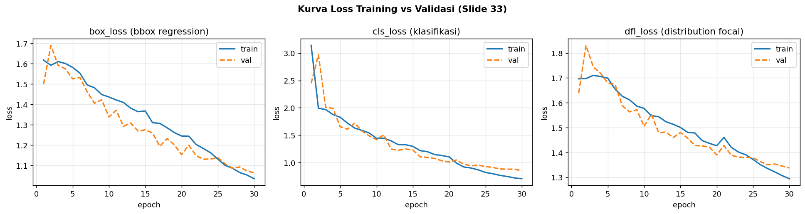
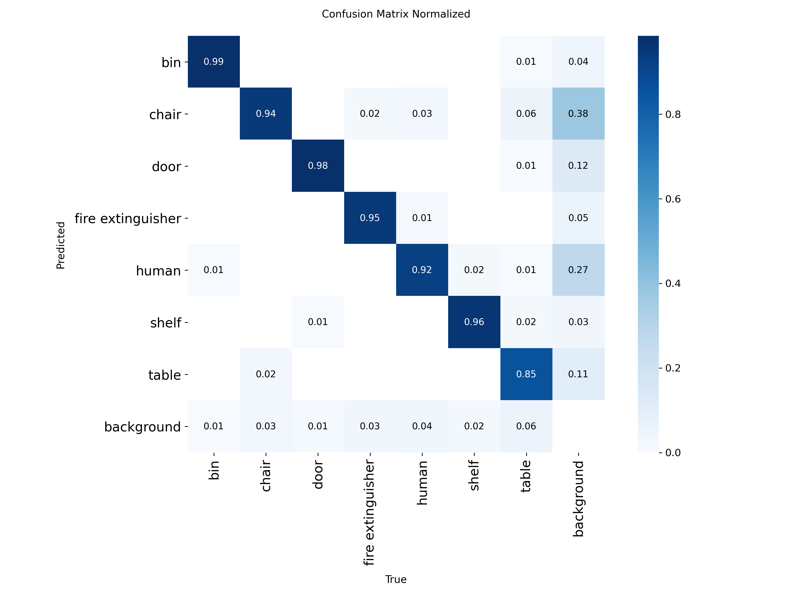
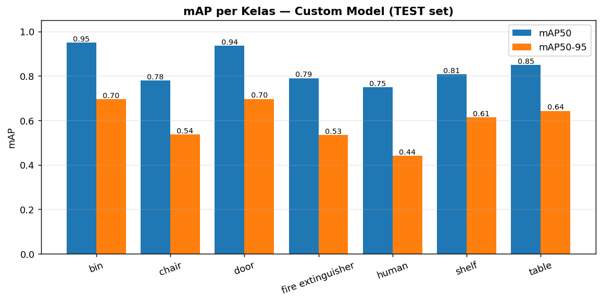
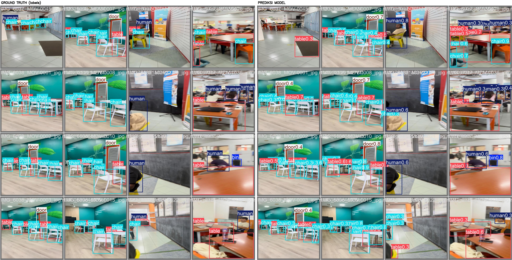
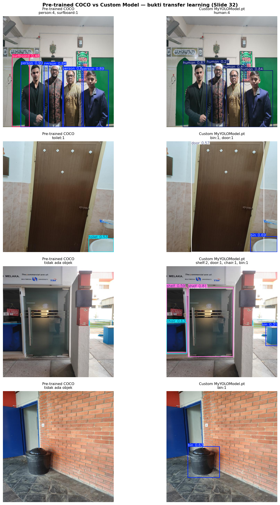

## 📎 Hasil ETS

Hasil lengkap ETS Object Detection dapat dilihat dan diunduh melalui tautan berikut:

- **[Buka folder Hasil_ETS_ObjectDetection](./Hasil_ETS_ObjectDetection/)** — berisi model, metrik, grafik evaluasi, dan hasil inferensi.
- **[Unduh Hasil_ETS_ObjectDetection.zip](./Hasil_ETS_ObjectDetection.zip)** — arsip lengkap hasil ETS.
- **[Baca ringkasan hasil ETS](./Hasil_ETS_ObjectDetection/README_HASIL.txt)** — konfigurasi training dan metrik validasi/test.

### 📊 Ringkasan Hasil

Model `yolo12n.pt` dilatih selama 30 epoch pada 7 kelas objek indoor menggunakan
`imgsz=640` dan `batch=16`.

| Split | Precision | Recall | mAP50 | mAP50-95 |
|---|---:|---:|---:|---:|
| Validation | 0.7830 | 0.7882 | 0.8306 | 0.5807 |
| Test | **0.8533** | 0.7474 | **0.8374** | **0.5941** |

### 🖼️ Gambar Hasil

#### Evaluasi Model

| Kurva training | Confusion matrix |
|---|---|
| [](./Hasil_ETS_ObjectDetection/ETS_results/training_curves.png) | [](./Hasil_ETS_ObjectDetection/ETS_results/confusion_matrix_normalized.png) |

| mAP per kelas | Perbandingan label dan prediksi |
|---|---|
| [](./Hasil_ETS_ObjectDetection/map_per_class.png) | [](./Hasil_ETS_ObjectDetection/ETS_results/perbandingan_labels_vs_pred.jpg) |

| Perbandingan COCO dan custom |
|---|
| [](./Hasil_ETS_ObjectDetection/ETS_results/compare_coco_vs_custom.png) |

#### Contoh Inferensi

[](./Hasil_ETS_ObjectDetection/hasil_inferensi/detection_result.jpg)

Contoh tambahan hasil inferensi tersedia di folder
[hasil_inferensi](./Hasil_ETS_ObjectDetection/hasil_inferensi/), sedangkan seluruh
grafik evaluasi tersedia di folder [ETS_results](./Hasil_ETS_ObjectDetection/ETS_results/).

---

# 🎯 ETS Elektronika Cerdas — Object Detection Indoor (YOLO)

**Transfer Learning Ultralytics YOLO pada dataset *Indoor Object Detection* (Mendeley)**

[](https://colab.research.google.com/github/zahran-rzq/DSEC_object_detection/blob/main/ETS_Object_Detection_Indoor_Colab.ipynb)
[](https://www.python.org/)
[](https://docs.ultralytics.com/)
[](https://data.mendeley.com/datasets/3ggxwf2vpr/1)

**Muhammad Zahran Razzaq** · Departemen Teknik Elektro — ITS Surabaya
Mata Kuliah **Elektronika Cerdas** (Dosen: **Prof. Djoko Purwanto**) · ETS *Object Detection*

---

## ⚡ Mulai dalam 1 Klik (saat ETS dimulai)

1. Buka repo ini di GitHub.
2. Klik tombol **Open in Colab** di atas (atau badge di bagian atas README).
3. Di Colab: **Runtime ▸ Change runtime type ▸ T4 GPU**.
4. **Runtime ▸ Run all** — selesai. Di akhir notebook, `Hasil_ETS_ObjectDetection.zip`
   terunduh otomatis.

> Tidak perlu upload file apa pun: dataset 433 MB diunduh otomatis dari Mendeley,
> ZIP bertumpuk diekstrak, anotasi VOC dikonversi ke YOLO, training, evaluasi,
> sampai bundel hasil — semua satu alur.

**Kalau waktu ujian mepet**, ubah hanya 2 baris di sel *Panel Kontrol Soal ETS*:

```python
SELECTED_CLASSES = None        # atau ['chair', 'door'] bila dosen minta sebagian kelas
MAX_TRAIN_IMAGES = 2000        # None = semua 12.012 gambar
EPOCHS = 30                    # default 60
```

---

## 📚 Isi Repositori

```
DSEC_object_detection/
├── ETS_Object_Detection_Indoor_Colab.ipynb   # ⭐ notebook utama (1 klik di Colab)
├── scripts_lokal/                            # script untuk VS Code lokal (dikumpulkan)
│   ├── 1_setup_dataset_mendeley.py           # unduh + ekstrak + konversi VOC→YOLO + data.yaml
│   ├── 2_train_yolo.py                       # transfer learning → MyYOLOModel.pt + metrik
│   ├── 3_predict_image.py                    # uji gambar statis (+ compare COCO vs custom)
│   └── 4_indoor_security_webcam.py           # webcam real-time: counter, auto-save, auto-record
├── voc_to_yolo.py                            # versi ringkas konverter VOC→YOLO
├── requirements.txt
├── .gitignore                                # dataset 433 MB, runs/, *.pt TIDAK ikut ter-push
└── README.md
```

**Tidak ada di repo (sengaja):** ZIP dataset 433 MB, `datasets/`, `runs/`, `MyYOLOModel.pt`.
Semua dihasilkan otomatis oleh script/notebook.

---

## 🧠 Yang Dipelajari & Diuji (sesuai materi 39 slide)

| Slide | Materi | Implementasi di repo ini |
|---|---|---|
| 3 | Object counting | Panel counter di webcam & simulasi security camera |
| 21 | 5 kriteria dataset | Sel evaluasi dataset + `RESPLIT_70_15_15` |
| 25 | Transfer learning + ONNX | `2_train_yolo.py` (`--export-onnx`) |
| 26 | IoU, P, R, mAP50, mAP50-95 | Sel evaluasi val & test, tabel per kelas |
| 28-31 | `from ultralytics import YOLO`, `yolo11n.pt`/`yolo12n.pt`, struktur dataset, class distribution | Notebook Tahap 2-4, `class_distribution.png` |
| 32 | Metrik keseluruhan & per kelas | `map_per_class.png` + CSV per kelas |
| 33 | `results.png` (box/cls/dfl loss) | `results.png` + `training_curves.png` |
| 34 | Confusion matrix | `confusion_matrix.png` |
| 35 | `val_batch0_labels.jpg` vs `val_batch0_pred.jpg` | `perbandingan_labels_vs_pred.jpg` |
| 36-38 | Inferensi gambar, webcam, security camera, auto-save & auto-record | `3_predict_image.py`, `4_indoor_security_webcam.py` |

---

## 📦 Dataset: *Indoor Object Detection* (Mendeley)

- **Sumber:** Nafiz Fahad — <https://data.mendeley.com/datasets/3ggxwf2vpr/1> (CC BY 4.0),
  diekspor dari Roboflow Universe `nafiz-fahad-1otyg/indoor-objects-1epjv`.
- **Unduh langsung:** [`Indoor Objects.v1i.voc.zip`](https://data.mendeley.com/public-files/datasets/3ggxwf2vpr/files/e9e913c0-e5eb-476b-a296-2ab55e55ada5/file_downloaded) — 433 MB.

| Split | Jumlah | Proporsi |
|---|---|---|
| `train` | 12.012 gambar | 94,2 % |
| `valid` | 490 gambar | 3,8 % |
| `test` | 245 gambar | 1,9 % |
| **Total** | **12.747 gambar** | 100 % |

Semua gambar **640×640 px**, sudah diaugmentasi 7× oleh penyusun (flip H/V, rotasi 90°,
rotasi acak ±15°, shear ±10°, brightness ±15 %).

### Tiga jebakan teknis (sudah ditangani otomatis)

1. **Anotasi masih Pascal VOC (`.xml`), bukan YOLO (`.txt`).**
   Script mengonversi `<bndbox><xmin,xmax,ymin,ymax>` + `<size>` menjadi
   `class_id x_center y_center width height` ternormalisasi, lalu **di-*clamp* ke `[0.0, 1.0]`**
   sehingga tidak ada warning *out-of-bounds* dari Ultralytics. Gambar dipindah dengan
   `os.link` (hardlink, instan) dan fallback `shutil.copy2`.
2. **Nama kelas `fire extinguisher` memakai SPASI** (bukan tanda hubung). Urutan 7 kelas:

   ```python
   CLASSES = ['bin', 'chair', 'door', 'fire extinguisher', 'human', 'shelf', 'table']
   ```

   Distribusi tidak seimbang: `chair` & `door` dominan; `shelf` dan `fire extinguisher`
   minoritas (test: `door` 175, `chair` 168, `human` 83, `table` 67, `bin` 65,
   `fire extinguisher` 49, `shelf` 20).
3. **Bug path `data.yaml` di Colab.** `path: .` membuat Ultralytics mencari ke
   `/content/datasets/datasets/...`. Script selalu menulis **path absolut**
   (`DATASET_DIR.resolve().as_posix()`).

Tambahan: tombol **“Download All”** Mendeley menghasilkan **ZIP di dalam ZIP**
(`Indoor Object Detection Dataset.zip` → `Indoor Objects.v1i.voc.zip`). Ekstraktor
melakukan **nested unzip** hingga 3 level, jadi kedua cara unduh sama-sama aman.

Hasil akhir struktur (sesuai Slide 30):

```
datasets/
├── train/{images,labels}
├── valid/{images,labels}
├── test/{images,labels}
data.yaml   # path (absolut), train, val, test, nc, names
```

---

## 💻 Jalankan di VS Code (lokal, untuk demo webcam)

```bash
# 1. Clone
git clone https://github.com/zahran-rzq/DSEC_object_detection.git
cd DSEC_object_detection

# 2. Virtual environment
python -m venv .venv
# Windows: .venv\Scripts\activate      Linux/macOS: source .venv/bin/activate

pip install -r requirements.txt
# GPU NVIDIA (opsional, jauh lebih cepat):
# pip install torch torchvision --index-url https://download.pytorch.org/whl/cu121

# 3. Siapkan dataset (unduh 433 MB + konversi VOC→YOLO + class distribution)
python scripts_lokal/1_setup_dataset_mendeley.py
#    hemat waktu / uji cepat:
#    python scripts_lokal/1_setup_dataset_mendeley.py --max-train 2000 --classes chair door

# 4. Training → MyYOLOModel.pt
python scripts_lokal/2_train_yolo.py --model yolo12n.pt --epochs 100
#    di laptop tanpa GPU, kecilkan:  --epochs 30 --imgsz 512 --batch 8

# 5. Uji gambar statis (Slide 36)
python scripts_lokal/3_predict_image.py --source contoh.jpg
python scripts_lokal/3_predict_image.py --source contoh.jpg --compare   # COCO vs custom

# 6. Webcam security camera (Slide 29, 37, 38)
python scripts_lokal/4_indoor_security_webcam.py --targets human door
```

### Kontrol keyboard `4_indoor_security_webcam.py`

| Tombol | Fungsi |
|---|---|
| `q` / `Esc` | keluar |
| `s` | simpan snapshot manual |
| `r` | mulai/hentikan rekaman manual |
| `c` | reset penghitung objek unik |
| `m` | mirror (flip) on/off |

Aplikasi ini otomatis:
- menampilkan **panel Object Counter** (jumlah objek per kelas di frame + total unik),
- menyimpan **`detection_result.jpg`** saat objek target terdeteksi,
- mulai **merekam `.mp4`** saat target muncul dan berhenti otomatis setelah target
  hilang selama `--record-secs` (default 6 s) → *post-roll recording*.

Opsi lain: `--source 0/1` (webcam), `--source video.mp4`, `--no-display` (headless),
`--no-record`, `--conf 0.4`, `--imgsz 480` (CPU lebih ringan).

---

## 📊 Artefak Evaluasi yang Dihasilkan

| File | Isi | Slide |
|---|---|---|
| `class_distribution.png` | Distribusi kelas (bar chart, total & per split) | 31 |
| `results.png` | Kurva `box_loss`, `cls_loss`, `dfl_loss` (train & val) + metrik | 33 |
| `training_curves.png` | Plot manual ketiga loss, train vs val | 33 |
| `confusion_matrix.png` | Confusion matrix (+ versi normalized) | 34 |
| `val_batch0_labels.jpg` / `val_batch0_pred.jpg` | Ground truth vs prediksi | 35 |
| `perbandingan_labels_vs_pred.jpg` | Keduanya disandingkan | 35 |
| `map_per_class.png` | mAP50 & mAP50-95 per kelas | 32 |
| `metrics_summary.txt`, `per_class_metrics_*.csv` | Metrik total & per kelas | 26, 32 |
| `compare_coco_vs_custom.png` | Pre-trained COCO vs custom model | 32 |
| `detection_result.jpg` | Hasil deteksi gambar/webcam | 36, 37 |
| `security_camera_recording.mp4` | Rekaman otomatis | 38 |
| `Hasil_ETS_ObjectDetection.zip` | Bundel semua di atas + `MyYOLOModel.pt` | — |

---

## 🧾 Ringkasan Poin Analisis (Slide 21, 26, 32–35)

**1. Dataset memenuhi 5 kriteria? (Slide 21)**
Jumlah gambar 12.747 → kategori **kompleks** (> 10.000) ✔. Namun **keseimbangan kelas buruk**
(`chair`/`door` dominan, `shelf`/`fire extinguisher` minoritas), dan split asli
**94/4/2** menyimpang dari ideal **70/15/15** → set `RESPLIT_70_15_15 = True` atau
jelaskan konsekuensinya (test set hanya 245 gambar → variansi metrik tinggi).
Kualitas anotasi baik (Roboflow), augmentasi sudah 7× dari penyusun.

**2. Arti metrik (Slide 26)**
`P = TP/(TP+FP)` (ketepatan prediksi), `R = TP/(TP+FN)` (cakupan objek asli),
`mAP50` = rata-rata AP pada IoU ≥ 0,50, `mAP50-95` = rata-rata AP pada
IoU 0,50:0,05:0,95 (lebih ketat → menguji presisi bbox). Selisih `mAP50 − mAP50-95`
menunjukkan seberapa rapi lokasi bbox. Threshold confidence menggeser trade-off P↔R.

**3. Metrik per kelas (Slide 32)**
Kelas minoritas (`shelf`, `fire extinguisher`) biasanya bermAP jauh lebih rendah.
Penyebab: sedikit instance → under-represented saat training. Solusi: oversampling,
augmentasi lebih agresif, tambah data, class weighting.

**4. Kurva loss (Slide 33)**
`box_loss` → presisi bbox, `cls_loss` → klasifikasi, `dfl_loss` → ketajaman tepi bbox.
Train & val turun bersama = sehat. Val naik saat train turun = **overfitting**
(turunkan epoch, perkuat augmentasi). Loss stagnan = learning rate / `data.yaml` bermasalah.

**5. Confusion matrix (Slide 34)**
Diagonal = benar. Kesalahan khas dataset ini: `chair` ↔ `table`, `door` ↔ `shelf`
(bentuk serupa). Baris `background` = false negative; kolom `background` = false positive.

**6. `val_batch0_labels` vs `val_batch0_pred` (Slide 35)**
Bandingkan jumlah/posisi bbox: objek GT hilang → recall rendah; bbox tambahan → precision
rendah; kelas tertukar → dikonfirmasi confusion matrix; bbox bergeser → menurunkan
`mAP50-95` meski `mAP50` masih tinggi.

**7. Bukti transfer learning**
`yolo12n.pt` (COCO) hanya mengenali `person`, `chair`, `dining table` dan **tidak**
mengenali `bin`, `door`, `fire extinguisher`, `shelf`. Setelah fine-tuning,
`MyYOLOModel.pt` mendeteksi 7 kelas indoor → transfer learning menghemat waktu & data.

> Isi tabel hasil eksperimen Anda (val/test) di sini setelah training:
>
> | Model | Kelas | Epoch | Box(P) | Box(R) | mAP50 | mAP50-95 |
> |---|---|---|---|---|---|---|
> | yolo12n (COCO) | 80 | — | — | — | — | — |
> | MyYOLOModel | 7 | 60 | | | | |

---

## 🛠️ Troubleshooting

| Gejala | Penyebab & solusi |
|---|---|
| `CUDA out of memory` | Kecilkan `BATCH` (16 → 8/4) atau `IMGSZ` (640 → 512). |
| `device=0` error di laptop | GPU tidak ada → `DEVICE='cpu'`; script otomatis mendeteksi. Pakai `--epochs 30`. |
| Ultralytics mencari `/content/datasets/datasets/...` | `data.yaml` memakai path relatif. Script selalu menulis **path absolut**; jangan diedit manual. |
| Warning `out of bounds` saat training | Label tidak di-clamp. Ulangi konversi dengan script ini (sudah clamp `[0,1]`). |
| `nc`/nama kelas kacau, objek salah label | `'fire extinguisher'` harus dengan **spasi** dan urutan `CLASSES` jangan diubah. |
| Colab: `cv2.VideoCapture(0)` tidak jalan | Webcam tidak bisa diakses dari server Colab. Pakai sel **webcam JavaScript** di notebook, atau jalankan script lokal. |
| Webcam lokal tidak terbuka | Kamera dipakai Zoom/Meet/browser → tutup dulu. Windows coba `--source 1`. Linux cek `ls -l /dev/video*`. |
| `VideoWriter` gagal / file 0 KB | Coba `--output-dir` lain, atau codec fallback sudah otomatis (`mp4v → avc1 → XVID`). |
| Training sangat lambat | Pastikan **Runtime ▸ T4 GPU** aktif; atau set `MAX_TRAIN_IMAGES = 2000`. |
| ZIP hasil tidak terunduh otomatis | Buka panel **Files** kiri Colab ▸ klik kanan `Hasil_ETS_ObjectDetection.zip` ▸ Download. |
| Repo terasa berat saat clone | Normal — dataset & model tidak di-commit (lihat `.gitignore`). |

---

## ✅ Checklist Pengumpulan (MyITS Classroom)

- [ ] **Nama & NRP di baris komentar awal setiap file `.py`**
      (`scripts_lokal/1..4`, `voc_to_yolo.py`) — sudah disediakan, tinggal isi NRP.
- [ ] Kompres menjadi **`Nama_NRP.zip`**, berisi minimal:
      `MyYOLOModel.pt`, `data.yaml`, notebook `.ipynb`, keempat script `scripts_lokal/`,
      `results.png`, `confusion_matrix.png`, `val_batch0_labels.jpg`,
      `val_batch0_pred.jpg`, `class_distribution.png`, `detection_result.jpg`,
      video rekaman security camera.
- [ ] Siap menjelaskan alur: dataset → konversi VOC→YOLO → transfer learning →
      evaluasi → aplikasi (webcam/security camera).

---

## 📄 Lisensi & Atribusi

- Kode dalam repo ini bebas dipakai untuk keperluan akademik ETS Elektronika Cerdas ITS.
- **Dataset:** *Indoor Object Detection Dataset* oleh **Nafiz Fahad**, lisensi
  **CC BY 4.0** (<https://data.mendeley.com/datasets/3ggxwf2vpr/1>).
  Sertakan atribusi ini di laporan.
- **Model:** Ultralytics YOLO11/YOLO12 (AGPL-3.0) — <https://github.com/ultralytics/ultralytics>.
